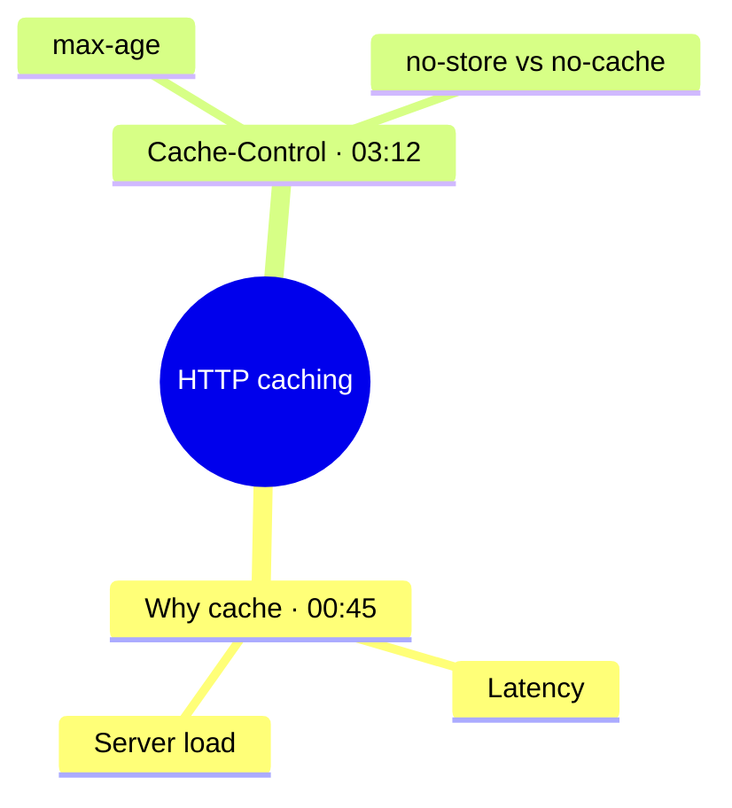

# YouTube to mind map

A good mind map shows the video's structure at a glance: one central topic, a few main branches in the order the
speaker covers them, and short leaves. It is a summary in tree form, so every branch must come from the transcript.

## 1. Get the transcript

If there is no saved transcript for this video yet, run the `youtube-transcript` skill's script with
`--via youtube-to-mindmap`. It saves `transcripts/<video_id>.<lang>.md` with `[mm:ss]` lines.

## 2. Build the tree

Read the file in parts of about 300 lines. For each part, note the topic the speaker is on and its key points.
Then merge into a tree:

- Root: the video's subject in a few words (not the full title).
- 4 to 7 main branches, in the order they appear in the video. End the label with the start time, e.g.
  `Caching · 03:12`, so the user can jump to it.
- 2 to 5 leaves per branch, each 2 to 6 words: a term, a number, a rule, an example. No full sentences.
- At most 3 levels below the root. Deeper trees stop being readable.

## 3. Output

Default to Mermaid, which renders in GitHub, Obsidian, Notion and most Markdown previews:

````markdown

````

Mermaid reads brackets as node shapes, so `Caching (03:12)` would show only "03:12". Keep `(` `)` `[` `]` `{` `}`
out of every label except the root's `(( ))`, and indent with two spaces per level.

If the user names another tool, use its format: Markmap (`#`/`##` headings and `-` bullets, for markmap.js or the
VS Code extension), OPML (XMind, MindNode, MindManager) or a nested Markdown list. Save the map as
`transcripts/<video_id>.mindmap.md` (or `.opml`) and tell the user the path.

## Optional

Pro users can call the server tool `create_mindmap` (MCP, spends AI runs) with the `job_id` from the transcript header.
